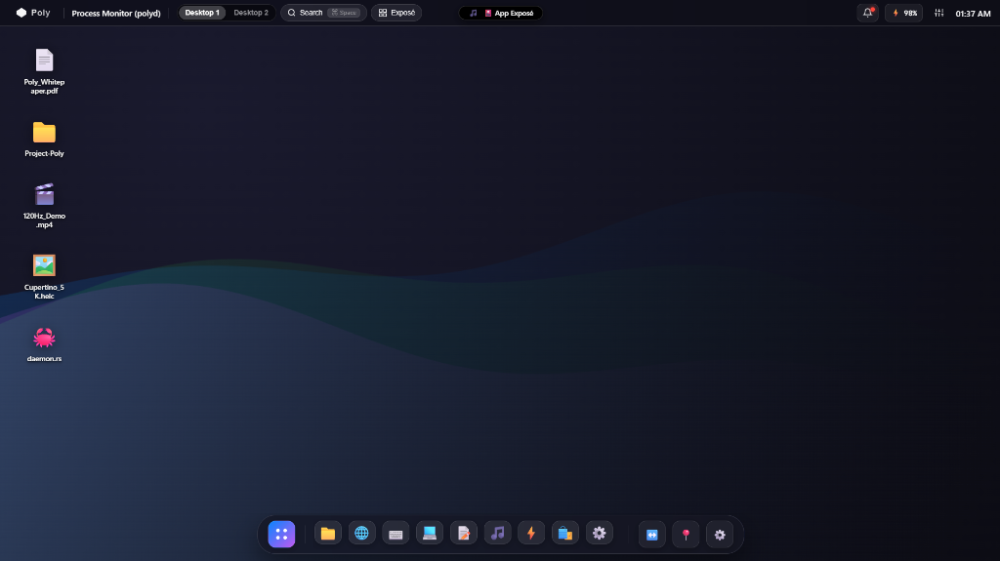
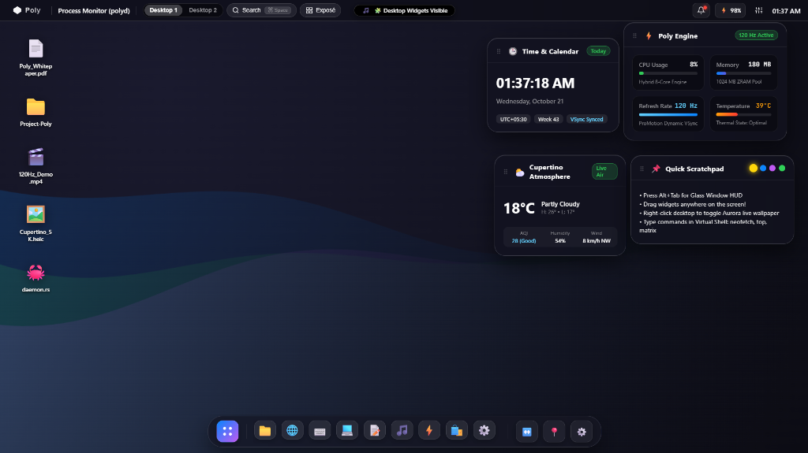
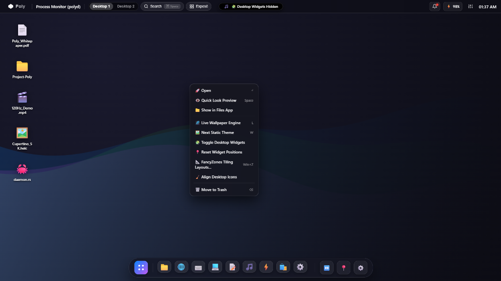
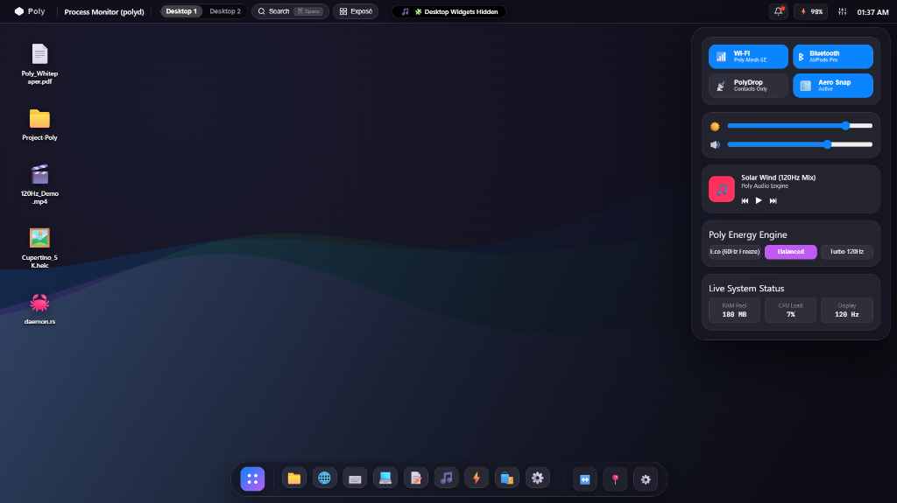
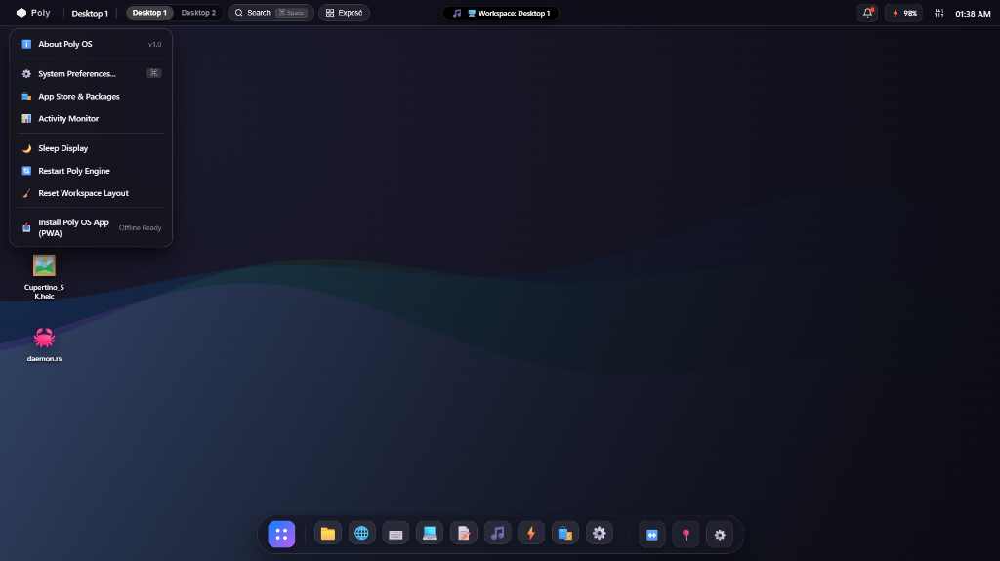

# Poly OS 🌐

<p align="center">
  
  
  
  
  
  
  
  
  
  
</p>

<p align="center">
  <strong>The ultra-lightweight hybrid desktop operating system marrying iOS tactile fluidity with Windows multitasking power — running directly on DRM/KMS hardware with GPU-accelerated frosted-glass rendering, dual-display support, and a 13-app ecosystem.</strong>
</p>

---

## 📖 Overview

**Poly OS** is an architectural and conceptual hybrid operating system designed to solve the trade-offs of modern desktop environments. 

Traditional desktop operating systems either prioritize **free-form multi-window productivity** at the cost of battery life and cohesive touch/gesture fluidity (Windows/macOS), or prioritize **aggressive battery efficiency and spring physics** at the cost of true floating window multitasking (iOS/iPadOS). 

Poly OS bridges this gap with:
1. **Damped Harmonic Oscillator Physics** running at 120Hz for zero-friction window drags, flicks, and velocity momentum.
2. **Proactive `cgroups v2` Lifecycle Freezing (`polyd`)** that freezes background windows after 15 seconds of inactivity into compressed ZRAM, preserving battery and guaranteeing **< 250 MB idle memory**.
3. **Adaptive Dual-Mode Taskbar**: Smoothly morphs from a floating frosted-glass iOS pill dock into an edge-to-edge Windows extended taskbar.
4. **Standardized 16px Aero Snap & FancyZones Tiling Grid**: Predictable half-screen, quarter-corner, and custom grid snapping with isolated corner drop shadows.
5. **DRM/KMS Direct Rendering**: No X11 dependency — the compositor talks directly to the GPU via Linux DRM/KMS with EGL/GLES 3.1 and optional Vulkan.
6. **Frosted-Glass GLSL Shaders**: Real-time 13-tap Gaussian blur with tinted alpha compositing for window borders, powered by a separable two-pass GPU pipeline.
7. **Multi-Monitor Extended Desktop**: Seamless dual-display support with BroadcastChannel window transit, draggable monitor topology, and per-display refresh rates.
8. **Keep-Alive Background Process Tray**: Music, Terminal, and Telemetry apps survive window close, running as background daemons with full system tray management.

---

## 📸 Visual Showcase

### 1. Minimalist Desktop & Adaptive Unified Dock
> *The signature desktop view featuring high-contrast vector gradient wallpapers, custom desktop icons, unified top status bar with Dynamic Island, and the auto-scaling frosted glass floating dock.*

<p align="center">
  
</p>

- **Unified Horizontal Baseline**: Pinned applications and active tasks share an identical vertical center with no stacked pseudo-rows.
- **Dynamic Auto-Scaling**: As more applications open, icons dynamically scale down from `42px` to `18px`, anchoring the right-hand system tray permanently on-screen.
- **Dynamic Island**: Displays interactive status prompts (e.g. `App Exposé`, workspace switches, audio device connections).

---

### 2. Live Desktop Widget Ecosystem
> *Glanceable, interactive desktop widgets providing live system metrics, weather, calendar, and quick thoughts.*

<p align="center">
  
</p>

- **Time & Calendar**: Live UTC/local time with week counters and VSync timing indicators.
- **Poly Engine Performance Monitor**: Synchronized single source of truth for CPU load, Memory pool (ZRAM compressed), 120Hz refresh rate, and thermal states.
- **Cupertino Atmosphere Weather**: Real-time atmospheric conditions, AQI, humidity, and wind vectors.
- **Quick Scratchpad**: Instant desktop sticky notes with theme tags and quick hotkey reminders.

---

### 3. Power-User Desktop Context Menu
> *Right-click anywhere on the desktop to reveal the fast context menu with desktop-wide utilities and controls.*

<p align="center">
  
</p>

- **Quick Look Preview (Spacebar)**: Instant spacebar preview for images, documents, and code files.
- **Next Live Wallpaper (`L`)**: Cycle through real-time animated canvas shader wallpapers (Aurora, Particles, Cupertino Glass, Off).
- **Next Static Theme (`W`)**: Rotate between 4 curated vector HDR colorways (*Cupertino Glass*, *Redmond Horizon*, *Nordic Aurora*, *Cyber Dusk*).
- **FancyZones Tiling Layouts (`Win + Z`)**: Launch customizable grid zones for power-user screen organization.
- **Toggle Desktop Widgets**: Instantly hide or reveal desktop widgets to keep workspaces distraction-free.

---

### 4. Glassmorphic Unified Control Center
> *A single click in the top-right status bar reveals the iOS-inspired Control Center with real-time sliders and toggles.*

<p align="center">
  
</p>

- **Quick Action Toggles**: 1-click toggles for Wi-Fi, Bluetooth, PolyDrop, Magnetic Aero Snap, Dark Mode, and Desktop Widgets — all synced with topbar indicator pills and Settings app checkboxes.
- **Interactive ProMotion Sliders**: Smooth volume and brightness control bars with screen brightness overlay.
- **Integrated Now Playing Media Controller**: Native spatial audio playback controls directly tied to the Poly Audio Engine.
- **Poly Energy Engine Profile Switcher**: Instantly switch between **Eco** (aggressive 60Hz freeze), **Balanced**, and **Turbo 120Hz** performance profiles.
- **Live System Status**: Real-time synchronized RAM Pool, CPU Load, and Display Hz telemetry snapshot.

---

### 5. Poly System Menu & Global Launcher
> *Top-left system menu offering instant access to core system tools, system preferences, and session controls.*

<p align="center">
  
</p>

- **System Preferences**: Full split-pane Settings app with 7 tabs for display, appearance, wallpapers, energy, multitasking, storage, and about.
- **Activity Monitor & Process Supervisor**: Deep inspection of background cgroups processes.
- **1-Click PWA Installation**: Install Poly OS as a native standalone desktop app on Chrome, Edge, and Safari.

---

## 🛠️ Architecture & Core Subsystems

```
poly-os/
├── .github/
│   ├── ISSUE_TEMPLATE/
│   │   ├── bug_report.yml            # Structured bug report form (component picker, 120Hz/60Hz)
│   │   ├── feature_request.yml       # RFC / enhancement proposal form
│   │   └── config.yml                # Template configuration & Discussions link
│   ├── workflows/
│   │   └── build-iso.yml             # CI/CD Live ISO pipeline
│   └── pull_request_template.md      # Contributor PR checklist & subsystem checkboxes
├── architecture/
│   └── SPECIFICATION.md              # Complete architectural blueprint & math formulas
├── docs/
│   └── screenshots/                  # High-resolution screenshots for GitHub
│       ├── desktop_dock.png
│       ├── desktop_widgets.png
│       ├── context_menu.png
│       ├── control_center.png
│       └── system_menu.png
├── poly-compositor/                  # ⚙️ Native Wayland compositor in Rust (DRM/KMS)
│   ├── Cargo.toml                    #    Smithay + glow + calloop + wayland-server deps
│   └── src/
│       ├── main.rs                   #    7-phase boot: DRM → EGL → Wayland → Glass → VSync loop
│       ├── backend.rs                #    DRM/KMS backend, VSync scheduler, compositor state
│       ├── shader.rs                 #    GLSL frosted-glass pipeline (blur + composite)
│       ├── physics.rs                #    Damped Harmonic Oscillator (Spring1D / Spring2D)
│       └── window.rs                 #    Magnetic Aero Snap & FancyZones tiling engine
├── poly-daemon/                      # 🔋 Battery & lifecycle supervisor in Python
│   ├── polyd.py                      #    cgroups v2 freezer + ZRAM telemetry REST API
│   └── polyd.toml                    #    User & system daemon configuration file
├── poly-shell/                       # 🖥️ Interactive Web Shell (120Hz Spring UI) — 15,600+ LOC
│   ├── index.html                    #    Shell DOM architecture (860+ lines)
│   ├── style.css                     #    Glassmorphic layout & gap system (5,400+ lines)
│   ├── shell.js                      #    Physics engine, window manager, 13 apps (10,300+ lines)
│   ├── display2.html                 #    Secondary monitor simulation window
│   ├── sw.js                         #    Service Worker for offline PWA caching
│   └── manifest.json                 #    PWA metadata & desktop icons
├── iso-build/                        # 💿 Bootable Live ISO pipeline
│   └── build-iso.sh                  #    Musl/Alpine Linux rootfs mastering script
├── test_issue17.js                   # 🧪 Keep-alive tray lifecycle tests
├── test_issue18.js                   # 🧪 Audio, stacking, accessibility, PID tests
├── test_issue19.js                   # 🧪 8-dir resize, compositor idle sleep, VFS tests
├── test_issue20_toggles_and_window_lifecycle.js  # 🧪 Toggle controls & window lifecycle tests
├── test_runtime_audit.js             # 🧪 Full runtime DOM boot & integration audit
├── preview.py                        # Zero-dependency local preview runner
├── CONTRIBUTING.md                   # Contributor guide: setup, standards, PR workflow
└── README.md
```

---

## 🧮 Mass-Spring-Damper Physics Engine

Windows in Poly OS do not jump or snap through rigid linear animations. Every window movement is governed by a second-order ordinary differential equation (ODE):

$$m \frac{d^2 x}{dt^2} + c \frac{dx}{dt} + k (x - x_{\text{target}}) = 0$$

- **Stiffness ($k = 260\ \text{N/m}$)**: Provides snappy, responsive window snap deceleration.
- **Damping Ratio ($\zeta = 0.82$)**: Calibrated for organic iOS-style overshoot bounce without infinite oscillation.
- **Velocity Retention**: Flicking a window titlebar calculates $\vec{v} = \frac{\Delta \vec{x}}{\Delta t}$ and integrates natural inertia before coming to rest.

**Spring presets** (from [`physics.rs`](poly-compositor/src/physics.rs)):
| Preset | Stiffness | Damping | Use Case |
|--------|-----------|---------|----------|
| `snappy()` | 320 | 0.85 | Window snap, minimize |
| `gentle()` | 180 | 0.88 | Dock hover, Control Center, App Exposé |
| `default()` | 240 | 0.82 | General window drag, resize |

---

## ⚙️ Hardware-Accelerated Compositor (`poly-compositor`)

The native Wayland compositor runs directly on Linux hardware via DRM/KMS — no X11 required.

### DRM/KMS Rendering Pipeline

```
┌──────────────────────────────────────────────────────────────┐
│                    Poly Compositor v0.3                       │
│                                                              │
│  ┌───────────┐    ┌──────────────┐    ┌───────────────────┐  │
│  │ libseat   │──▶│ DRM Backend   │──▶│ CRTC / Connector  │  │
│  │ (session) │    │ (Page Flip)  │    │ (Physical Output) │  │
│  └───────────┘    └──────┬───────┘    └───────────────────┘  │
│                         │                                    │
│  ┌──────────┐    ┌──────▼───────┐   ┌───────────────────┐    │
│  │ Wayland  │──▶│ EGL/GLES 3.1 │──▶│ Glass Shader      │    │
│  │ Display  │    │ Renderer     │   │ (blur + tint)     │    │
│  └──────────┘    └──────────────┘   └───────────────────┘    │
│                                                              │
│  ┌────────────────────────────────────────────────────┐      │
│  │  calloop EventLoop (120Hz timer + DRM + Wayland)   │      │
│  └────────────────────────────────────────────────────┘      │
└──────────────────────────────────────────────────────────────┘
```

### Key Components

| Module | Lines | Description |
|--------|-------|-------------|
| [`main.rs`](poly-compositor/src/main.rs) | 260+ | 7-phase boot sequence: DRM probe → EGL init → Wayland globals → glass shader compile → demo windows → snap test → 120Hz VSync loop |
| [`backend.rs`](poly-compositor/src/backend.rs) | 380+ | `OutputConfig` (DPI/scale), `VSyncScheduler` (adaptive 120→60Hz), `RendererContext` (GPU caps), `PolyCompositorState` (window map, focus stack), dual-output topology |
| [`shader.rs`](poly-compositor/src/shader.rs) | 230+ | GLSL pipeline: fullscreen vertex, 13-tap separable Gaussian blur, frosted-glass composite (saturation + tint + noise grain) |
| [`physics.rs`](poly-compositor/src/physics.rs) | 150 | `Spring1D` / `Spring2D` / `SpringConfig` — semi-implicit Euler integration |
| [`window.rs`](poly-compositor/src/window.rs) | 150 | `PolyWindow` / `SnapZone` — 8-zone magnetic snap with spring-animated transitions |

### Frosted-Glass GLSL Shader

The compositor renders window borders with real-time Gaussian-blurred frosted glass:

```
┌──────────────────────┐
│  Compositor FBO      │  (all surfaces composited)
└──────────┬───────────┘
           │  blit / down-sample ×4
┌──────────▼───────────┐
│  Blur Ping-Pong FBOs │  Two-pass separable 13-tap Gaussian (σ ≈ 4.0)
│  (horiz → vert)      │
└──────────┬───────────┘
           │  blurred + original → tinted alpha blend
┌──────────▼───────────┐
│  Glass Composite FBO │  + saturation boost + noise grain (anti-banding)
└──────────────────────┘
```

### Adaptive VSync Scheduler

The compositor targets **120 Hz** with automatic degradation:
- **EWMA tracking** of per-frame render time (α = 0.3)
- After **3 consecutive deadline misses** → drops to **60 Hz** half-rate
- **Self-healing**: recovers to 120 Hz when render time falls below 75% of frame budget
- Statistics: total frames, missed deadlines, average render time

### Wayland Protocol Support

| Protocol | Version | Purpose |
|----------|---------|---------|
| `wl_compositor` | v5 | Surface creation & management |
| `xdg_wm_base` | v5 | Window management (toplevel, popup) |
| `wl_seat` | — | Keyboard, pointer, touch input |
| `wp_viewporter` | — | Sub-pixel surface scaling |
| `wp_fractional_scale_v1` | — | HiDPI fractional scaling (1×, 1.5×, 2×) |
| `xdg_decoration_manager_v1` | — | Server-side decoration negotiation |
| `xwayland` | — | X11 compatibility for legacy apps |

### Building the Compositor (Linux)

```bash
# Install system dependencies (Ubuntu/Debian)
sudo apt install -y build-essential pkg-config \
  libwayland-dev libdrm-dev libgbm-dev libudev-dev \
  libseat-dev libegl-dev libgles2-mesa-dev \
  libxkbcommon-dev libinput-dev

# Install Rust
curl --proto '=https' --tlsv1.2 -sSf https://sh.rustup.rs | sh
source ~/.cargo/env

# Build and run
cd poly-compositor
cargo build --release
cargo run
```

---

## 🔋 Proactive Memory & Process Freezing (`polyd`)

Instead of allowing inactive background processes to consume memory and CPU cycles:
1. **Focus Tracking**: When a user focuses a new window, the previously active window is placed on a **15-second grace countdown**.
2. **`cgroups v2` Freezing**: Once the timer expires, `polyd` writes `1` to `/sys/fs/cgroup/poly.slice/app_<id>/cgroup.freeze`.
3. **ZRAM Compaction**: Kernel memory pages for frozen apps are swapped into in-RAM compressed ZRAM.
4. **Instant Thaw**: Clicking the app icon or Alt+Tab instantly writes `0` to unfreeze, restoring interactive state in $< 10\ \text{ms}$.

### ZRAM Telemetry & Algorithm Selector

The daemon exposes real-time ZRAM metrics via a REST API:

| Endpoint | Method | Description |
|----------|--------|-------------|
| `/api/telemetry` | GET | Full process lifecycle & ZRAM metrics |
| `/api/status` | GET | Daemon health status |
| `/api/zram/stats` | GET | Raw kernel `mm_stat` breakdown |
| `/api/zram/algorithm` | GET/POST | Query or switch compression algorithm |

**Supported algorithms:**
- **⚡ LZ4**: ~0.4ms latency, ~3.24× compression — optimized for interactive responsiveness
- **📦 ZSTD**: ~1.8ms latency, ~4.28× compression — optimized for maximum memory savings

```bash
# Run the daemon with REST API
python polyd.py --server --port 5174

# CLI inspection
python polyd.py --zram-stats
python polyd.py --set-algorithm zstd
```

---

## 🖥️ Interactive Web Shell (`poly-shell`)

The web shell is a fully interactive browser-based preview of the Poly OS desktop experience, comprising **15,600+ lines of code** across HTML, CSS, and JavaScript.

### Built-in Applications (13 Apps)

| App | Icon | Features |
|-----|------|----------|
| **Files Explorer** | 📁 | Virtual filesystem (PolyVFS) with nested subfolders, breadcrumb navigation, back/forward history, Quick Look preview, search filter, drag & drop |
| **Poly Browser** | 🌐 | URL bar with navigation (back, forward, reload), homepage, embedded iframe renderer |
| **Poly Terminal** | ⌨️ | `neofetch`, `ps`, `top`, `kill`, `matrix`, `ls`, `cat`, `cd`, `theme`, `power`, `clear` — with command history and arrow key recall |
| **Notes** | 📝 | Rich text editor with inter-app drag & drop text insertion, file attachment links |
| **Music Player** | 🎵 | Web Audio synthesizer + real-time 32-band canvas visualizer, multi-track playlist, keep-alive background playback |
| **Process Monitor** | 📊 | Live synchronized system metrics (CPU, RAM, temperature, refresh rate), per-process PID table with kill support |
| **Code Studio** | 💻 | Multi-tab editor with syntax highlighting (Rust, Python, JS, HTML, Markdown), line numbers, bracket auto-close, sandbox runner with timing |
| **System Settings** | ⚙️ | 7-tab split-pane app: Appearance, Display & 120Hz, Wallpapers & Sound, Energy Engine, Multitasking, Storage & ZRAM, About |
| **Poly App Store** | 🏪 | Browse curated categories, install third-party apps (Canvas, Arcade, Calculator) with simulated package verification |
| **Canvas Studio** | 🎨 | Freeform drawing app with color picker, brush sizes, and eraser (installable from App Store) |
| **Poly Arcade** | 🕹️ | Built-in Pong game with keyboard controls and AI opponent (installable from App Store) |
| **Calculator** | 🧮 | Standard scientific calculator with display history (installable from App Store) |
| **Quick Look** | 👁️ | Spacebar-triggered file preview modal for images, code, and documents |

### Window Management

| Feature | Trigger | Description |
|---------|---------|-------------|
| **Aero Snap** | Drag to edges/corners | Magnetic half-screen and quarter-corner snapping with 16px gaps |
| **Snap Assist** | Auto after snap | Suggests split partner from remaining windows |
| **Snap Layouts Flyout** | Hover maximize button | Visual grid picker for snap zones |
| **FancyZones** | `Win + Z` or `Shift + drag` | Customizable tiling layouts (columns, rows, grid, widescreen, golden ratio) |
| **Alt+Tab Switcher** | `Alt + Tab` | Glassmorphic HUD with window preview cards |
| **App Exposé** | `Win + Tab` / `Ctrl + Tab` | 3D overview grid of all running windows |
| **Workspace Slide** | `Ctrl + ←/→` | 120Hz spring-animated virtual desktop transitions |
| **8-Dir Resize** | Drag edges/corners | N, S, E, W, NW, NE, SW, SE resize handles with cursor feedback |
| **Close Window** | `✕` / `Ctrl+W` / `Alt+F4` | Spring exit animation + defocus fallback; keep-alive apps hide to tray |
| **Force Quit** | `Shift+✕` or double-click `✕` | Terminates keep-alive daemons immediately |
| **Immersive Mode** | Maximize (topbar integration) | Top status bar merges with window titlebar |
| **Multi-Monitor Transit** | Drag to right edge | Transfers window to secondary display via BroadcastChannel |

### Live Wallpaper Engine

Three real-time canvas shader wallpapers with DPI-aware rendering and intelligent pause:
- **`aurora`** — Harmonic flowing sine waves (cyan, emerald, purple)
- **`particles`** — 55 interactive nodes with cursor-reactive connections
- **`cupertino`** — Breathing radial glassmorphic gradient
- **`off`** — Static wallpaper only (saves GPU cycles)

Wallpaper rendering automatically pauses when:
- The browser tab is hidden (`document.hidden`)
- A maximized window obscures the desktop

### Centralized Toggle System

All toggle controls are bidirectionally synchronized across the Control Center, Topbar indicator pills, and Settings App:

| Toggle | Control Center | Topbar | Settings | localStorage Key |
|--------|---------------|--------|----------|-----------------|
| Wi-Fi | `#toggle-wifi` | `#topbar-wifi` | — | `poly_wifi_enabled` |
| Bluetooth | `#toggle-bluetooth` | `#topbar-bluetooth` | — | `poly_bluetooth_enabled` |
| PolyDrop | `#toggle-airdrop` | — | — | `poly_drop_mode` |
| Aero Snap | `#toggle-stage` | — | `#snap-toggle` | `poly_aero_snap` |
| Process Freezer | — | — | `#freezer-toggle` | `poly_freezer_enabled` |
| GPU Acceleration | — | — | `#hw-accel-toggle` | `poly_hw_accel` |
| Display Scale | — | — | `#display-scale-select` | `poly_display_scale` |
| Dark Mode | `#toggle-appearance-theme` | — | Appearance cards | `poly_appearance_mode` |
| Desktop Widgets | `#toggle-desktop-widgets` | — | — | `poly_desktop_widgets_visible` |

### Multi-Monitor Extended Desktop

Poly OS supports a simulated dual-display extended desktop:

- **Secondary Display Window** (`display2.html`): Opens as a separate browser window synchronized via `BroadcastChannel`.
- **Draggable Topology Canvas**: Click-to-swap monitor arrangement in Settings → Display tab.
- **Window Transfer**: Drag any window to the right screen edge to transit it to Display 2.
- **Recall All**: One-click recall of all windows back to the primary display.
- **Independent Refresh Rates**: Display 1 at 120Hz, Display 2 at 60Hz.

### Dock System

The dock morphs between two modes persisted in `localStorage`:

| Mode | Style | Activation |
|------|-------|------------|
| **Floating Pill** | Rounded frosted-glass island centered at bottom | Default, or via dock settings / Spotlight |
| **Full Taskbar** | Edge-to-edge bar with Start button and window strip | Toggle in dock settings, or via Spotlight search |

Features:
- **Running Indicators**: Dot badges under pinned apps with active window count.
- **Window Strip**: In taskbar mode, unpinned running windows appear in a scrollable strip.
- **Auto-Scaling**: Icon sizes dynamically compress from 42px → 18px as more apps open.
- **Dock Alignment**: Center or Left alignment, persisted across sessions.
- **Dock Settings Popup**: Segmented control for mode and alignment.

---

## 🧪 Test Suite

Poly OS includes a comprehensive automated test suite with **50+ test cases** across 5 test files:

| Test File | Tests | Coverage |
|-----------|-------|----------|
| `test_issue17.js` | 4 | Keep-alive tray lifecycle, background restore, force quit, regular close |
| `test_issue18.js` | 10 | Audio synthesis, stacking hierarchy, search wiring, drag & drop, PID alignment, layout thrashing, defocus, media controls, accessibility, Spotlight navigation |
| `test_issue19.js` | 10 | 8-directional resize handles, compositor idle sleep, DPI-aware wallpaper, VFS subfolders, breadcrumb navigation, folder traversal |
| `test_issue20_toggles_and_window_lifecycle.js` | 15 | Titlebar elevation, keyboard close shortcuts, repeat close, tray maximized cleanup, brightness overlay, Wi-Fi/Bluetooth/PolyDrop/Snap toggles, Settings wiring, freezer toggle, dock persistence, compositor wake, App Store mapping, context menu, audio mute, multi-display close |
| `test_runtime_audit.js` | 12+ | Full runtime DOM mock boot, `window.polyOS` global assignment, live wallpaper cycling with localStorage persistence, context menu auto-dismiss, window close button click-through, keep-alive tray behavior, double-close force quit, Wi-Fi/Bluetooth/PolyDrop/Snap/Freezer/HW Accel toggle round-trips |

Run the full test matrix:

```bash
node test_issue17.js
node test_issue18.js
node test_issue19.js
node test_issue20_toggles_and_window_lifecycle.js
node test_runtime_audit.js
```

---

## 💿 Automated Live Bootable ISO Pipeline (`iso-build`)

Poly OS includes a fully automated CI/CD pipeline using **GitHub Actions** (`.github/workflows/build-iso.yml`) to master and publish a bootable hybrid ISO (`poly-os-x86_64.iso`):

- **Dual Boot Capability**: Boots on modern **UEFI (x86_64)** systems with Secure Boot fallback and legacy **BIOS (i386-pc)** machines.
- **SquashFS Rootfs**: High-ratio Zstandard (`zstd -Xcompression-level 19`) compression bundling:
  - Compiled release binary of `poly-compositor` (Smithay + DRM/KMS + GLES 3.1)
  - `polyd` process supervisor and ZRAM optimization daemon
  - Complete `poly-shell` assets, fonts, wallpapers, and desktop web applications
  - Custom OpenRC low-latency init scripts (`/etc/init.d/poly`) and sysctl tuning
- **Automated Checksums & Release**: Calculates `SHA256SUMS` and uploads artifacts to GitHub Actions workflow runs (14-day retention) and creates GitHub Release downloads on version tags (`v*`).

### Building the Live ISO Locally (Linux)

```bash
# Install mastering dependencies (Ubuntu/Debian)
sudo apt install -y squashfs-tools xorriso grub-pc-bin grub-efi-amd64-bin mtools dosfstools

# Run build script
bash iso-build/build-iso.sh

# The ISO will be produced in iso-build/out/poly-os-x86_64-v0.1.iso
```

---

## ⚡ Try Poly OS Locally

Poly OS includes a zero-dependency interactive preview runner:

```bash
# Clone the repository
git clone https://github.com/your-username/poly-os.git
cd poly-os

# Start the interactive preview server (web shell)
python preview.py
# → Opens http://localhost:5173/index.html

# Run the native compositor demo (Linux only)
cd poly-compositor
cargo run
```

### Key Shortcuts to Test

| Category | Shortcut | Action |
|----------|----------|--------|
| **Launcher** | `Cmd/Win + Space` | Open Global Spotlight / Start Launcher |
| **Window Switching** | `Alt + Tab` | Fast Glass Window Switcher HUD |
| **Exposé** | `Win + Tab` / `Ctrl + Tab` | Toggle 3D App Exposé overview |
| **Quick Look** | `Spacebar` | Preview selected desktop file |
| **FancyZones** | `Win + Z` | Trigger tiling layout overlay |
| **FancyZones (drag)** | `Shift + Drag` | Live grid overlay with zone highlighting |
| **Zone Snap** | `Win + 1..4` | Snap active window to Zone 1–4 |
| **Aero Snap** | Drag to top edge | Magnetic maximize |
| **Split Snap** | Drag to left/right edge | 50% split-screen with 16px gaps |
| **Corner Snap** | Drag to corners | 25% quarter snap |
| **Live Wallpaper** | `L` | Cycle live wallpaper engine |
| **Static Theme** | `W` | Cycle static wallpaper theme |
| **Close Window** | `Ctrl + W` / `Alt + F4` | Close active window (keep-alive apps hide to tray) |
| **Minimize** | `Ctrl + M` | Minimize active window with spring animation |
| **Workspaces** | `Ctrl + ←/→` | Switch virtual desktop |
| **Multi-Monitor** | `Alt + Shift + →` | Transfer window to secondary display |

---

## 📋 Changelog (Issues Resolved)

| Issue | Title | Key Deliverables |
|-------|-------|-----------------|
| #15 | Multi-Monitor Extended Desktop | `PolyDisplayManager`, `BroadcastChannel` sync, `display2.html`, draggable topology canvas, per-display refresh rates |
| #16 | Universal Inter-App Drag & Drop | `HTML5 DnD` + custom `dragPayload` system, file/text/selection drag between Files, Code, Notes, Terminal |
| #17 | Keep-Alive Background Process Tray | Music/Terminal/Telemetry survive close, system tray with context menus, restore-from-tray, force quit |
| #18 | Audio, Polish & Accessibility | `PolyAudio` Web Audio synthesis, `aria-live` regions, focus rings, PID alignment, layout thrashing elimination |
| #19 | 8-Directional Resize & Compositor Optimization | 8 resize handles (N/S/E/W/NW/NE/SW/SE), compositor idle sleep, DPI-aware wallpaper, PolyVFS nested subfolders |
| #20 | Toggle Controls & Shell Resilience | Centralized Wi-Fi/BT/PolyDrop/Snap/Freezer/HW toggles, brightness overlay, titlebar z-index fix, keyboard close shortcuts, dock silent init |

---

## 🤝 Contributing

Contributions are welcome! Please check out [CONTRIBUTING.md](CONTRIBUTING.md) for local environment setup, architecture overviews, coding standards, and pull request guidelines.

### Quick Start for Contributors

```bash
# Web shell development
python preview.py                  # Live preview at localhost:5173

# Compositor development (Linux / WSL2)
cd poly-compositor
cargo check                        # Syntax & type check
cargo build                        # Full build
cargo run                          # Run demo

# Daemon development
python polyd.py --server --port 5174   # REST API server
python polyd.py --zram-stats           # CLI inspection

# Run test suite
node test_issue17.js
node test_issue18.js
node test_issue19.js
node test_issue20_toggles_and_window_lifecycle.js
node test_runtime_audit.js
```

---

## 📄 License

Poly OS is open-source software licensed under the **[MIT License](LICENSE)**.
