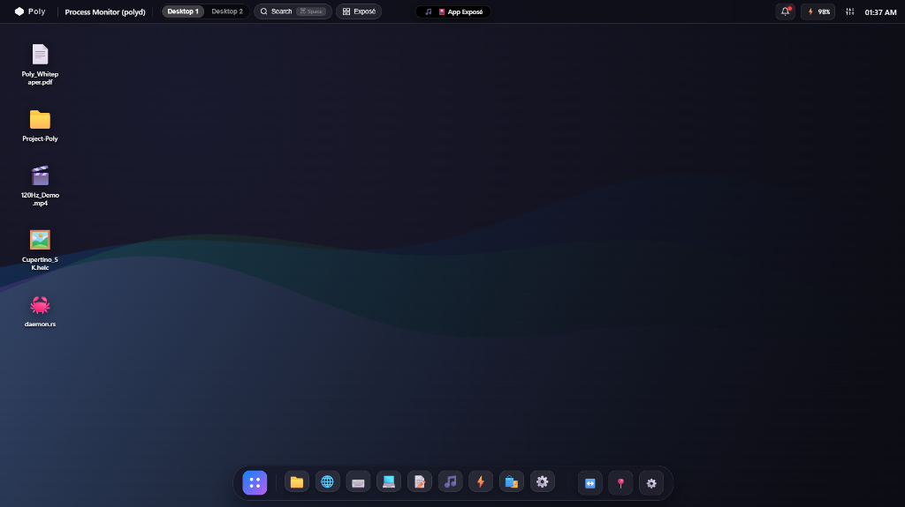
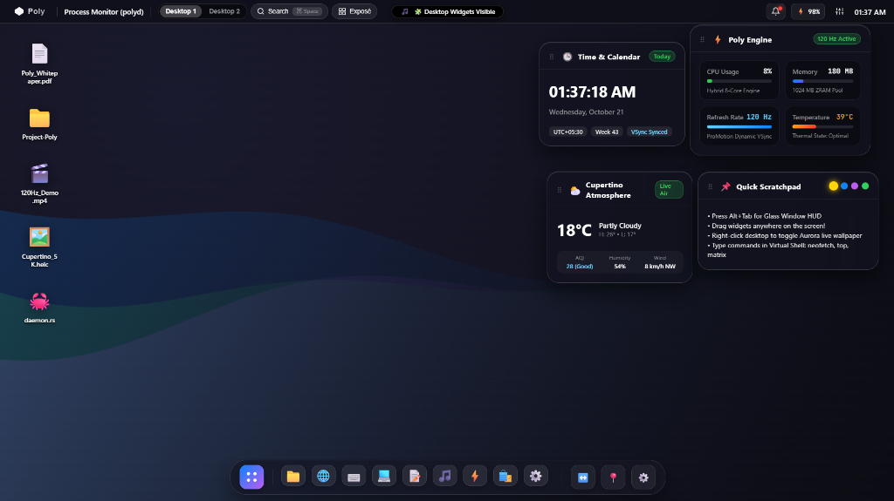
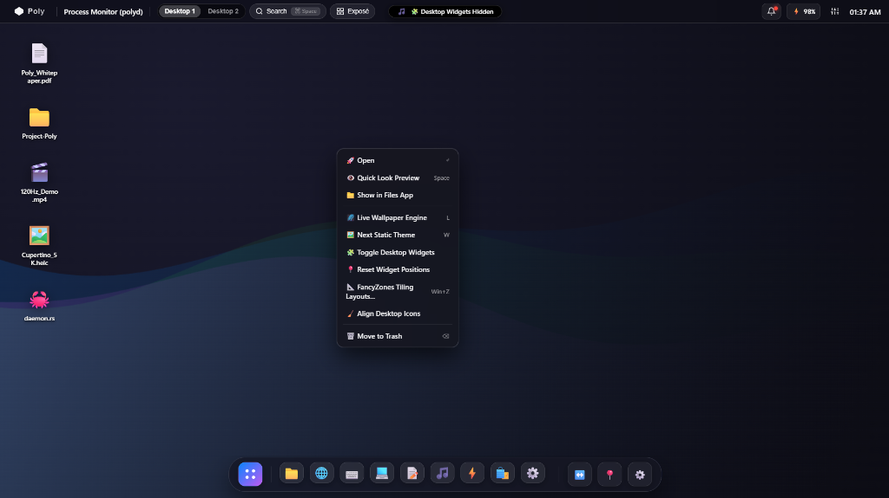
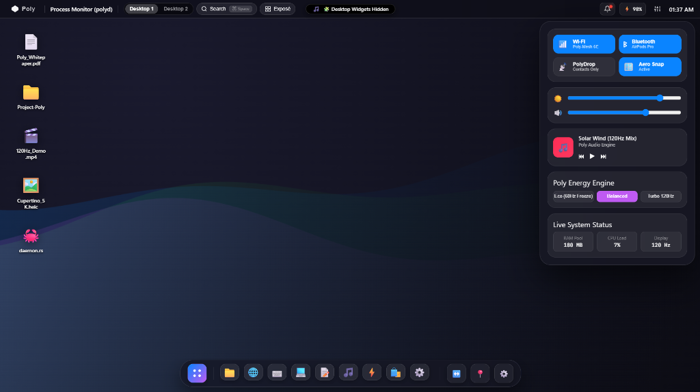
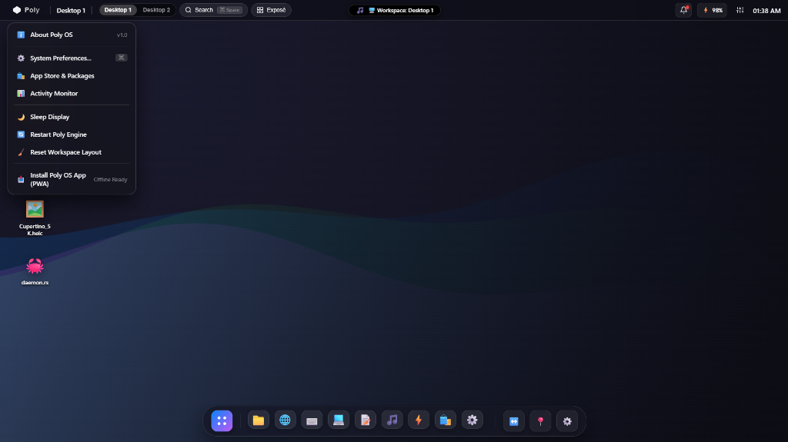

# Poly OS 🌐

<p align="center">
  
  
  
  
  
  
  
</p>

<p align="center">
  <strong>The ultra-lightweight hybrid desktop operating system marrying iOS tactile fluidity with Windows multitasking power — running directly on DRM/KMS hardware with GPU-accelerated frosted-glass rendering.</strong>
</p>

---

## 📖 Overview

**Poly OS** is an architectural and conceptual hybrid operating system designed to solve the trade-offs of modern desktop environments. 

Traditional desktop operating systems either prioritize **free-form multi-window productivity** at the cost of battery life and cohesive touch/gesture fluidity (Windows/macOS), or prioritize **aggressive battery efficiency and spring physics** at the cost of true floating window multitasking (iOS/iPadOS). 

Poly OS bridges this gap with:
1. **Damped Harmonic Oscillator Physics** running at 120Hz for zero-friction window drags, flicks, and velocity momentum.
2. **Proactive `cgroups v2` Lifecycle Freezing (`polyd`)** that freezes background windows after 15 seconds of inactivity into compressed ZRAM, preserving battery and guaranteeing **< 250 MB idle memory**.
3. **Adaptive Dual-Mode Taskbar**: Smoothly morphs from a floating frosted-glass iOS pill dock into an edge-to-edge Windows extended taskbar.
4. **Standardized 16px Aero Snap & FancyZones Tiling Grid**: Predictable half-screen, quarter-corner, and custom grid snapping with isolated corner drop shadows.
5. **DRM/KMS Direct Rendering**: No X11 dependency — the compositor talks directly to the GPU via Linux DRM/KMS with EGL/GLES 3.1 and optional Vulkan.
6. **Frosted-Glass GLSL Shaders**: Real-time 13-tap Gaussian blur with tinted alpha compositing for window borders, powered by a separable two-pass GPU pipeline.

---

## 📸 Visual Showcase

### 1. Minimalist Desktop & Adaptive Unified Dock
> *The signature desktop view featuring high-contrast vector gradient wallpapers, custom desktop icons, unified top status bar with Dynamic Island, and the auto-scaling frosted glass floating dock.*

<p align="center">
  
</p>

- **Unified Horizontal Baseline**: Pinned applications and active tasks share an identical vertical center with no stacked pseudo-rows.
- **Dynamic Auto-Scaling**: As more applications open, icons dynamically scale down from `42px` to `18px`, anchoring the right-hand system tray permanently on-screen.
- **Dynamic Island**: Displays interactive status prompts (e.g. `App Exposé`, workspace switches, audio device connections).

---

### 2. Live Desktop Widget Ecosystem
> *Glanceable, interactive desktop widgets providing live system metrics, weather, calendar, and quick thoughts.*

<p align="center">
  
</p>

- **Time & Calendar**: Live UTC/local time with week counters and VSync timing indicators.
- **Poly Engine Performance Monitor**: Synchronized single source of truth for CPU load, Memory pool (ZRAM compressed), 120Hz refresh rate, and thermal states.
- **Cupertino Atmosphere Weather**: Real-time atmospheric conditions, AQI, humidity, and wind vectors.
- **Quick Scratchpad**: Instant desktop sticky notes with theme tags and quick hotkey reminders.

---

### 3. Power-User Desktop Context Menu
> *Right-click anywhere on the desktop to reveal the fast context menu with desktop-wide utilities and controls.*

<p align="center">
  
</p>

- **Quick Look Preview (Spacebar)**: Instant spacebar preview for images, documents, and code files.
- **Live Wallpaper Engine**: Toggle real-time animated Cupertino shaders or switch between 4 curated vector colorways (*Cupertino Glass*, *Redmond Horizon*, *Nordic Aurora*, *Cyber Dusk*).
- **FancyZones Tiling Layouts (`Win + Z`)**: Launch customizable grid zones for power-user screen organization.
- **Toggle Desktop Widgets**: Instantly hide or reveal desktop widgets to keep workspaces distraction-free.

---

### 4. Glassmorphic Unified Control Center
> *A single click in the top-right status bar reveals the iOS-inspired Control Center with real-time sliders and toggles.*

<p align="center">
  
</p>

- **Quick Action Toggles**: 1-click toggles for Wi-Fi, Bluetooth, PolyDrop, and Magnetic Aero Snap.
- **Interactive ProMotion Sliders**: Smooth volume and brightness control bars.
- **Integrated Now Playing Media Controller**: Native spatial audio playback controls directly tied to the Poly Audio Engine.
- **Poly Energy Engine Profile Switcher**: Instantly switch between **Eco** (aggressive 60Hz freeze), **Balanced**, and **Turbo 120Hz** performance profiles.

---

### 5. Poly System Menu & Global Launcher
> *Top-left system menu offering instant access to core system tools, system preferences, and session controls.*

<p align="center">
  
</p>

- **System Preferences**: Full split-pane Settings app for display refresh rates, acoustics, multitasking springs, and ZRAM caches.
- **Activity Monitor & Process Supervisor**: Deep inspection of background cgroups processes.
- **1-Click PWA Installation**: Install Poly OS as a native standalone desktop app on Chrome, Edge, and Safari.

---

## 🛠️ Architecture & Core Subsystems

```
poly-os/
├── .github/
│   ├── ISSUE_TEMPLATE/
│   │   ├── bug_report.yml            # Structured bug report form (component picker, 120Hz/60Hz)
│   │   ├── feature_request.yml       # RFC / enhancement proposal form
│   │   └── config.yml                # Template configuration & Discussions link
│   └── pull_request_template.md      # Contributor PR checklist & subsystem checkboxes
├── architecture/
│   └── SPECIFICATION.md              # Complete architectural blueprint & math formulas
├── docs/
│   └── screenshots/                  # High-resolution screenshots for GitHub
│       ├── desktop_dock.png
│       ├── desktop_widgets.png
│       ├── context_menu.png
│       ├── control_center.png
│       └── system_menu.png
├── poly-compositor/                  # ⚙️ Native Wayland compositor in Rust (DRM/KMS)
│   ├── Cargo.toml                    #    Smithay + glow + calloop + wayland-server deps
│   └── src/
│       ├── main.rs                   #    7-phase boot: DRM → EGL → Wayland → Glass → VSync loop
│       ├── backend.rs                #    DRM/KMS backend, VSync scheduler, compositor state
│       ├── shader.rs                 #    GLSL frosted-glass pipeline (blur + composite)
│       ├── physics.rs                #    Damped Harmonic Oscillator (Spring1D / Spring2D)
│       └── window.rs                 #    Magnetic Aero Snap & FancyZones tiling engine
├── poly-daemon/                      # 🔋 Battery & lifecycle supervisor in Python
│   ├── polyd.py                      #    cgroups v2 freezer + ZRAM telemetry REST API
│   └── polyd.toml                    #    User & system daemon configuration file
├── poly-shell/                       # 🖥️ Interactive Web Shell (120Hz Spring UI)
│   ├── index.html                    #    Shell DOM architecture
│   ├── style.css                     #    Glassmorphic layout & gap system
│   ├── shell.js                      #    Physics engine, window manager & state store
│   └── manifest.json                 #    PWA metadata & desktop icons
├── iso-build/                        # 💿 Bootable Live ISO pipeline
│   └── build-iso.sh                  #    Musl/Alpine Linux rootfs mastering script
├── preview.py                        # Zero-dependency local preview runner
├── CONTRIBUTING.md                   # Contributor guide: setup, standards, PR workflow
└── README.md
```

---

## 🧮 Mass-Spring-Damper Physics Engine

Windows in Poly OS do not jump or snap through rigid linear animations. Every window movement is governed by a second-order ordinary differential equation (ODE):

$$m \frac{d^2 x}{dt^2} + c \frac{dx}{dt} + k (x - x_{\text{target}}) = 0$$

- **Stiffness ($k = 260\ \text{N/m}$)**: Provides snappy, responsive window snap deceleration.
- **Damping Ratio ($\zeta = 0.82$)**: Calibrated for organic iOS-style overshoot bounce without infinite oscillation.
- **Velocity Retention**: Flicking a window titlebar calculates $\vec{v} = \frac{\Delta \vec{x}}{\Delta t}$ and integrates natural inertia before coming to rest.

**Spring presets** (from [`physics.rs`](poly-compositor/src/physics.rs)):
| Preset | Stiffness | Damping | Use Case |
|--------|-----------|---------|----------|
| `snappy()` | 320 | 0.85 | Window snap, minimize |
| `gentle()` | 180 | 0.88 | Dock hover, Control Center, App Exposé |
| `default()` | 240 | 0.82 | General window drag, resize |

---

## ⚙️ Hardware-Accelerated Compositor (`poly-compositor`)

The native Wayland compositor runs directly on Linux hardware via DRM/KMS — no X11 required.

### DRM/KMS Rendering Pipeline

```
┌──────────────────────────────────────────────────────────────┐
│                    Poly Compositor v0.2                      │
│                                                              │
│  ┌───────────┐    ┌──────────────┐    ┌───────────────────┐  │
│  │ libseat   │──▶│ DRM Backend   │──▶│ CRTC / Connector  │  │
│  │ (session) │    │ (Page Flip)  │    │ (Physical Output) │  │
│  └───────────┘    └──────┬───────┘    └───────────────────┘  │
│                         │                                    │
│  ┌──────────┐    ┌──────▼───────┐   ┌───────────────────┐    │
│  │ Wayland  │──▶│ EGL/GLES 3.1 │──▶│ Glass Shader      │    │
│  │ Display  │    │ Renderer     │   │ (blur + tint)     │    │
│  └──────────┘    └──────────────┘   └───────────────────┘    │
│                                                              │
│  ┌────────────────────────────────────────────────────┐      │
│  │  calloop EventLoop (120Hz timer + DRM + Wayland)   │      │
│  └────────────────────────────────────────────────────┘      │
└──────────────────────────────────────────────────────────────┘
```

### Key Components

| Module | Lines | Description |
|--------|-------|-------------|
| [`main.rs`](poly-compositor/src/main.rs) | 260+ | 7-phase boot sequence: DRM probe → EGL init → Wayland globals → glass shader compile → demo windows → snap test → 120Hz VSync loop |
| [`backend.rs`](poly-compositor/src/backend.rs) | 310+ | `OutputConfig` (DPI/scale), `VSyncScheduler` (adaptive 120→60Hz), `RendererContext` (GPU caps), `PolyCompositorState` (window map, focus stack) |
| [`shader.rs`](poly-compositor/src/shader.rs) | 230+ | GLSL pipeline: fullscreen vertex, 13-tap separable Gaussian blur, frosted-glass composite (saturation + tint + noise grain) |
| [`physics.rs`](poly-compositor/src/physics.rs) | 150 | `Spring1D` / `Spring2D` / `SpringConfig` — semi-implicit Euler integration |
| [`window.rs`](poly-compositor/src/window.rs) | 150 | `PolyWindow` / `SnapZone` — 8-zone magnetic snap with spring-animated transitions |

### Frosted-Glass GLSL Shader

The compositor renders window borders with real-time Gaussian-blurred frosted glass:

```
┌──────────────────────┐
│  Compositor FBO      │  (all surfaces composited)
└──────────┬───────────┘
           │  blit / down-sample ×4
┌──────────▼───────────┐
│  Blur Ping-Pong FBOs │  Two-pass separable 13-tap Gaussian (σ ≈ 4.0)
│  (horiz → vert)      │
└──────────┬───────────┘
           │  blurred + original → tinted alpha blend
┌──────────▼───────────┐
│  Glass Composite FBO │  + saturation boost + noise grain (anti-banding)
└──────────────────────┘
```

### Adaptive VSync Scheduler

The compositor targets **120 Hz** with automatic degradation:
- **EWMA tracking** of per-frame render time (α = 0.3)
- After **3 consecutive deadline misses** → drops to **60 Hz** half-rate
- **Self-healing**: recovers to 120 Hz when render time falls below 75% of frame budget
- Statistics: total frames, missed deadlines, average render time

### Wayland Protocol Support

| Protocol | Version | Purpose |
|----------|---------|---------|
| `wl_compositor` | v5 | Surface creation & management |
| `xdg_wm_base` | v5 | Window management (toplevel, popup) |
| `wl_seat` | — | Keyboard, pointer, touch input |
| `wp_viewporter` | — | Sub-pixel surface scaling |
| `wp_fractional_scale_v1` | — | HiDPI fractional scaling (1×, 1.5×, 2×) |
| `xdg_decoration_manager_v1` | — | Server-side decoration negotiation |
| `xwayland` | — | X11 compatibility for legacy apps |

### Building the Compositor (Linux)

```bash
# Install system dependencies (Ubuntu/Debian)
sudo apt install -y build-essential pkg-config \
  libwayland-dev libdrm-dev libgbm-dev libudev-dev \
  libseat-dev libegl-dev libgles2-mesa-dev \
  libxkbcommon-dev libinput-dev

# Install Rust
curl --proto '=https' --tlsv1.2 -sSf https://sh.rustup.rs | sh
source ~/.cargo/env

# Build and run
cd poly-compositor
cargo build --release
cargo run
```

---

## 🔋 Proactive Memory & Process Freezing (`polyd`)

Instead of allowing inactive background processes to consume memory and CPU cycles:
1. **Focus Tracking**: When a user focuses a new window, the previously active window is placed on a **15-second grace countdown**.
2. **`cgroups v2` Freezing**: Once the timer expires, `polyd` writes `1` to `/sys/fs/cgroup/poly.slice/app_<id>/cgroup.freeze`.
3. **ZRAM Compaction**: Kernel memory pages for frozen apps are swapped into in-RAM compressed ZRAM.
4. **Instant Thaw**: Clicking the app icon or Alt+Tab instantly writes `0` to unfreeze, restoring interactive state in $< 10\ \text{ms}$.

### ZRAM Telemetry & Algorithm Selector

The daemon exposes real-time ZRAM metrics via a REST API:

| Endpoint | Method | Description |
|----------|--------|-------------|
| `/api/telemetry` | GET | Full process lifecycle & ZRAM metrics |
| `/api/status` | GET | Daemon health status |
| `/api/zram/stats` | GET | Raw kernel `mm_stat` breakdown |
| `/api/zram/algorithm` | GET/POST | Query or switch compression algorithm |

**Supported algorithms:**
- **⚡ LZ4**: ~0.4ms latency, ~3.24× compression — optimized for interactive responsiveness
- **📦 ZSTD**: ~1.8ms latency, ~4.28× compression — optimized for maximum memory savings

```bash
# Run the daemon with REST API
python polyd.py --server --port 5174

# CLI inspection
python polyd.py --zram-stats
python polyd.py --set-algorithm zstd
```

---

## 🖥️ Interactive Web Shell (`poly-shell`)

The web shell is a fully interactive browser-based preview of the Poly OS desktop experience.

### Built-in Applications

| App | Features |
|-----|----------|
| **Poly Terminal** | `neofetch`, `ps`, `top`, `kill`, `matrix`, `ls`, `cat`, `theme`, `power` — with command history |
| **Files Explorer** | Virtual filesystem, breadcrumb navigation, back/forward history, Quick Look preview, search filter |
| **Music Player** | Web Audio synthesizer + real-time 32-band canvas visualizer |
| **Code Studio** | Multi-tab editor with syntax highlighting (Rust, Python, JS, HTML, Markdown), line numbers, bracket auto-close, sandbox runner with timing |
| **System Settings** | Display, ZRAM, performance profiles, about system |

### Window Management

| Feature | Trigger |
|---------|---------|
| **Aero Snap** | Drag to edges/corners |
| **Snap Assist** | Auto-suggests split partner |
| **FancyZones** | `Win + Z` or `Shift + drag` |
| **Alt+Tab Switcher** | `Alt + Tab` glass HUD |
| **App Exposé** | `Win + Tab` / `Ctrl + Tab` |
| **Workspace Slide** | 120Hz spring transitions |

### Live Wallpaper Engine

Three real-time canvas shader wallpapers:
- **`aurora`** — Harmonic flowing sine waves (cyan, emerald, purple)
- **`particles`** — 55 interactive nodes with cursor-reactive connections
- **`cupertino`** — Breathing radial glassmorphic gradient

---

## ⚡ Try Poly OS Locally

Poly OS includes a zero-dependency interactive preview runner:

```bash
# Clone the repository
git clone https://github.com/your-username/poly-os.git
cd poly-os

# Start the interactive preview server (web shell)
python preview.py
# → Opens http://localhost:5173/index.html

# Run the native compositor demo (Linux only)
cd poly-compositor
cargo run
```

### Key Shortcuts to Test:
- **`Cmd / Win + Space`**: Open Global Spotlight / Start Launcher.
- **`Win + Tab` / `Ctrl + Tab`**: Toggle 3D App Exposé overview.
- **`Alt + Tab`**: Fast Glass Window Switcher HUD.
- **`Spacebar`**: Quick Look file preview when an icon is selected.
- **`Win + Z`**: Trigger FancyZones multi-window tiling layouts.
- **`Shift + Drag`**: Live FancyZones grid overlay with zone highlighting.
- **`Win + 1..4`**: Snap active window to Zone 1–4 of current layout.
- **Drag window to top edge**: Magnetic Aero Maximize.
- **Drag window to left / right**: 50% split-screen snap with strict 16px gaps.
- **Drag window to corners**: 25% quarter corner snap.
- **`L`**: Toggle live wallpaper engine.

---

## 🤝 Contributing

Contributions are welcome! Please check out [CONTRIBUTING.md](CONTRIBUTING.md) for local environment setup, architecture overviews, coding standards, and pull request guidelines.

### Quick Start for Contributors

```bash
# Web shell development
python preview.py                  # Live preview at localhost:5173

# Compositor development (Linux / WSL2)
cd poly-compositor
cargo check                        # Syntax & type check
cargo build                        # Full build
cargo run                          # Run demo

# Daemon development
python polyd.py --server --port 5174   # REST API server
python polyd.py --zram-stats           # CLI inspection
```

---

## 📄 License

Poly OS is open-source software licensed under the **[MIT License](LICENSE)**.
